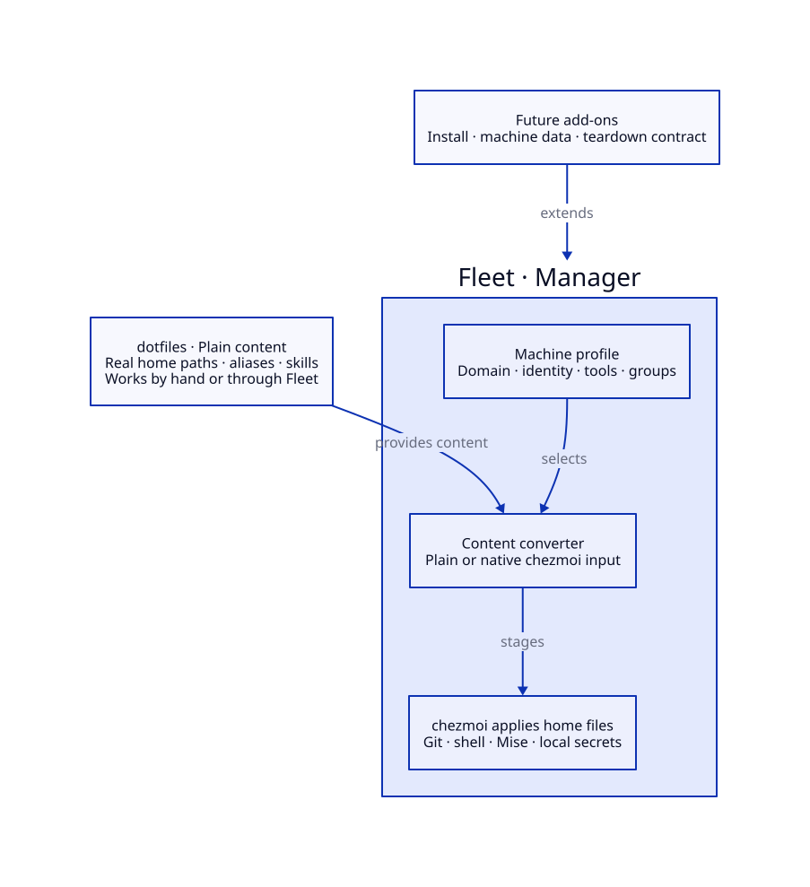

# dotfiles

A standalone, chezmoi-managed shell and Git scaffold, built from a sanitized
existing Workbench configuration. Git stores the source, chezmoi renders it for
one machine and domain, and Mise manages tools. You can use this layer on its own.

**v0.0.1 is a migration candidate on `feat/chezmoi-v0.0.1`. Main still contains
Workbench. Do not migrate an existing machine until the owner has reviewed the
[legacy inventory](docs/LEGACY-INVENTORY.md), local WSL changes, and preservation
tag.** See [blockers and acceptance status](docs/BLOCKERS.md).



Dotfleet will consume dotfiles to provide onboarding and fleet profiles.
Add-ons will extend Dotfleet. Neither is required here; there is no custom sync
engine, GUI, daemon, or agent pack.

## Install

Prerequisites: Bash, Git, curl, tar and zsh; Linux, macOS or WSL. For example, a
fresh Ubuntu container needs `apt-get install -y git curl ca-certificates tar zsh`.
Bootstrap installs missing chezmoi and Mise into `~/.local/bin`. Python 3.11+ is
needed only for the optional agent generator. Authenticate Git before cloning this
private repository. Native Windows bootstrap is deferred; use WSL.

Clone the migration candidate and run one setup command:

```sh
git clone --branch feat/chezmoi-v0.0.1 https://github.com/jeremyspofford/dotfiles.git
cd dotfiles
bash scripts/bootstrap.sh --branch feat/chezmoi-v0.0.1 --domain core
```

Choose `personal`, `work` or `client` to select another overlay. Domains begin with
the shared core and contain empty, documented customization points; no invented
personal aliases are added. Existing source directories must have the same Git
origin; otherwise choose a new `--source /absolute/path`. Review existing machine
configuration before applying.

To use **your own trusted chezmoi repository**, use this bootstrap as tooling:

```sh
bash scripts/bootstrap.sh --repo https://github.com/you/dotfiles.git --dry-run
bash scripts/bootstrap.sh --repo https://github.com/you/dotfiles.git
```

Both modes initialize a checkout and validate templates with `chezmoi diff`
before applying. Dry-run installs tools and initializes source/config state but
does not apply dotfiles. Diff content is suppressed to keep secrets out of logs.
A failing diff prevents apply. A repo can run code through templates and hooks;
dry-run is validation, not a sandbox. The own-repo mode does not inject this
project's aliases, domain values, secrets template, or agents.

Open zsh after setup. Set it as your login shell separately if desired.
Starship, eza, fzf and other integrations activate only when installed. The
[optional Workbench Mise profile](docs/examples/workbench-tools.toml) preserves
the existing tool choices; it is not automatically installed.

## Usage

```sh
chezmoi status
chezmoi diff                   # May display secrets; use only in a private terminal.
chezmoi apply
chezmoi update                 # Git pull plus apply; ordinary chezmoi behavior.
bash scripts/generate-agent-configs.sh --dry-run
bash scripts/generate-agent-configs.sh
bash scripts/bootstrap.sh --help
```

Change `[data].domain` in `~/.config/chezmoi/chezmoi.toml`, then apply again.
The repository's `.chezmoi.toml.tmpl` creates this machine-local configuration.
Names and email addresses are optional template data or can stay in
`~/.config/git/local.gitconfig`; see the [sanitized example](docs/examples/local.gitconfig).

Secrets are disabled by default, so a fresh machine gets a private, comment-only
`~/.secrets`. To enable a value, install/sign in to 1Password CLI and set
`secretsEnabled = true` and `secretReference = "op://YourVault/YourItem/field"`
under local `[data]`, then apply. Only references belong in source control.
The rendered file is mode 0600, shell-escaped, and ignored by both repository and
managed global Git ignore rules. Never run `chezmoi add ~/.secrets`.

## How it works

| Source of truth | Generated result |
| --- | --- |
| `dot_zshenv`, `dot_zprofile`, `dot_zshrc` | Shell startup files |
| `core/aliases.zsh` plus selected domain | `~/.aliases` |
| `dot_config/` templates and files | Platform/domain fragments, prompt, Git ignore, Mise settings |
| `dot_gitconfig.tmpl` plus local data | `~/.gitconfig` |
| `.chezmoitemplates/dot_secrets.tmpl` | `~/.secrets` via `private_dot_secrets.tmpl` |
| `agents/manifest.toml`, `agents/skills/` | Native configs, skill links and output inventory |
| `docs/diagrams/layers.d2` | Committed `layers.svg` |

The `private_` chezmoi attribute protects secrets permissions; the named secrets
template holds the content in one place. Source-only directories are excluded by
`.chezmoiignore`. Every output and regeneration command is listed in
[GENERATED.md](docs/GENERATED.md). Agent defaults and limitations, including
Ollama's environment-only model, are documented in [AGENTS.md](docs/AGENTS.md).

## Development and review

```sh
shellcheck -x scripts/*.sh
shfmt -d scripts/*.sh
python3 -m unittest discover -s tests -p 'test_*.py' -v
npm install --ignore-scripts
npm run test:release
d2 --layout=dagre docs/diagrams/layers.d2 docs/diagrams/layers.svg
```

CI runs shell checks, a fresh Linux-container bootstrap, isolated chezmoi
dry-run/apply tests, release-policy tests and D2 rendering. D2 is pinned to 0.7.1
in CI. Read [DESIGN.md](docs/DESIGN.md) for boundaries and [RELEASES.md](docs/RELEASES.md)
for the owner-only 1.0.0 gate and pending live release test. VERSION is the
version source; Conventional Commit subjects become plain-language changelog entries.

This repository remains private. The existing history includes personal metadata;
sanitizing the current source does not sanitize historical commits.
